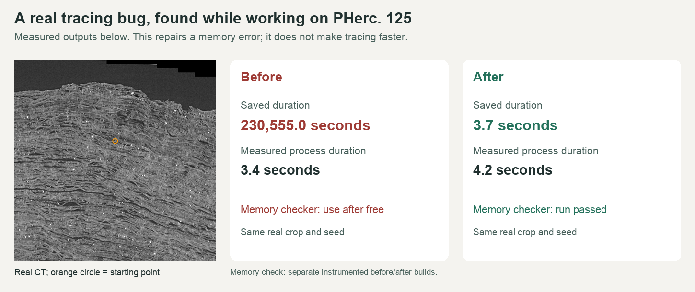

# GrowPatch timer lifetime repair

A small fix for `vc_grow_seg_from_seed` in [ScrollPrize/villa](https://github.com/ScrollPrize/villa), with evidence from a real PHerc0125 tracing run. Published by Matthew Kelly, with investigation, development and testing assisted by OpenAI Codex/ChatGPT.

While preparing a scroll surface for ink-reading, the tool reported roughly **64 hours for a run that took seconds**. Its final save read a timer after deleting it. This repository shares the patch and captured evidence for review; it is not an upstream-accepted fix or an award announcement.

## The fix

[keep-timer-alive.patch](keep-timer-alive.patch) moves the existing `delete timer` until after `create_surface_from_state()` has read the timer and saved the final surface metadata. It changes two added lines and one removed line, including a comment. Tracing equations, thresholds and numerical precision are unchanged.

## Before and after

| Check | Original | Patched |
| --- | --- | --- |
| Native process wall time | 3.394 s | 4.154 s |
| Final `elapsed_time_s` | 230,554.989 s | 3.695 s |
| Real-data sanitizer validation | Invalid read reproduced in four instrumented runs | Five direct runs and a standalone check completed without AddressSanitizer errors |

These timings are **correctness checks, not a speed benchmark**. The original native executable exited successfully despite saving a corrupted elapsed value. The instrumented original caught a heap-use-after-free in finalization. See [original result](original-native-result.json), [patched result](patched-verified-result.json), and [evidence summary](evidence.json).



The image is a figure made from the recorded results, with real CT context. It is not a screenshot of a terminal. Captured logs are available directly:

- [Instrumented original: invalid read](baseline-deterministic.log)
- [Instrumented patched trace](patched-deterministic.log)
- [Original published executable](original-native-trace.log)
- [Patched standalone regression check](patched-verified-trace.log)

## Real scroll input

- Scroll: **PHerc0125**; scan **20250821151825**; voxel size **9.362 micrometres**.
- Surface-prediction crop, Z/Y/X bounds (upper end excluded): `[10016,10784)`, `[2816,3584)`, `[3712,4480)`.
- Local XYZ seed: `[384,310,384]`; global XYZ: `[4096,3126,10400]`.
- The tracer used published surface predictions and generated local normal grids. The CT slice in the figure is visual context, not the tracer's direct input.
- [Input provenance](surface-input-provenance.json) provides the public data URLs, array checksum, crop and coordinate details. [CT provenance](ct-context-provenance.json) documents the illustration.

No synthetic fixture was used. Full input volumes and normal-grid assets are not redistributed here.

## Reproducing the regression check

This is a review and regression-check package, not a standalone installation of Volume Cartographer. Obtain the upstream source, its build dependencies, the specified public crop, and matching local normal grids first. Follow the upstream build documentation for your platform.

Tested installed-app source: [`fb8c2c4c2705746eefb42e9bb359560906f391e2`](https://github.com/ScrollPrize/villa/tree/fb8c2c4c2705746eefb42e9bb359560906f391e2). The patch also applied to checked main revision [`a329895ea5e9bde78752e60dbc0a4878dd2ab909`](https://github.com/ScrollPrize/villa/tree/a329895ea5e9bde78752e60dbc0a4878dd2ab909); full main was not built.

1. Build an original tracer from the tested source, enabling AddressSanitizer where available.
2. Apply the patch in that source checkout, then build the repaired tracer separately:

   ```sh
   git apply /path/to/keep-timer-alive.patch
   ```

3. Copy [params-template.json](params-template.json) and replace `normal_grid_path` with your local normal-grid directory.
4. Run the [standalone checker](check_real_scroll.py) on each executable using a different, previously nonexistent output directory:

   ```sh
   python3 check_real_scroll.py \
     --executable /path/to/vc_grow_seg_from_seed \
     --volume /path/to/surface-crop.zarr \
     --params /path/to/params.json \
     --output /path/to/new/check-output \
     --seed 384 310 384
   ```

The checker preserves the command, trace log and result JSON. It checks native exit status, finite nonnegative elapsed metadata bounded by process wall time plus one second, and the absence of an AddressSanitizer error. Passing without an instrumented binary alone does not establish memory safety. It does not certify surface accuracy.

For the original narrow macOS library-replacement experiment, the checker also accepts `--library-directory` and `--asan-runtime`. When a replacement library is specified, it verifies that the expected library appears in the loader log. The original app, matching dependencies, and local build setup are not bundled here; a normal upstream build is the intended starting point for independent reproduction.

## Scope and limits

- Tested on Apple M1, macOS arm64, with a targeted tracer-library rebuild against the official app dependencies. Linux, other architectures, full main and the entire monorepo suite were not tested.
- [Repeatability results](repeatability-check.json) show matching valid masks and generation maps for the reported comparison, but coordinates were not bit-identical. Repeated unmodified baseline traces also varied.
- This fixes invalid memory access and timing metadata. It does not claim faster tracing, new letters, improved geometric accuracy, or measured human hours saved.
- The evidence files are records of the local experiment and retain their original status wording, including that nothing had been submitted at that time. Publication here does not mean an upstream PR or prize entry has been submitted.
- The separate Qt viewer repairs by other contributors and our performance experiments are not included in this contribution.

## Attribution and license

The upstream project is Vesuvius Challenge's [villa](https://github.com/ScrollPrize/villa), licensed under MIT; its notice is preserved in [LICENSE-upstream.txt](LICENSE-upstream.txt). The patch context retains upstream ownership. The original patch, checker and documentation contributed here are also available under the [MIT License](LICENSE). Public scan data retains its original terms and attribution; it is not relicensed by this repository.

This evidence and explanation were prepared with AI assistance. No personal-review certification or upstream acceptance is implied. Before an upstream PR, the project's contribution guidelines request the contributor's own motivation and personal review, plus screenshots of actual before/after tool behavior.
